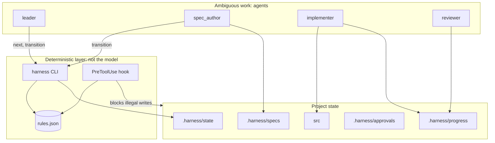
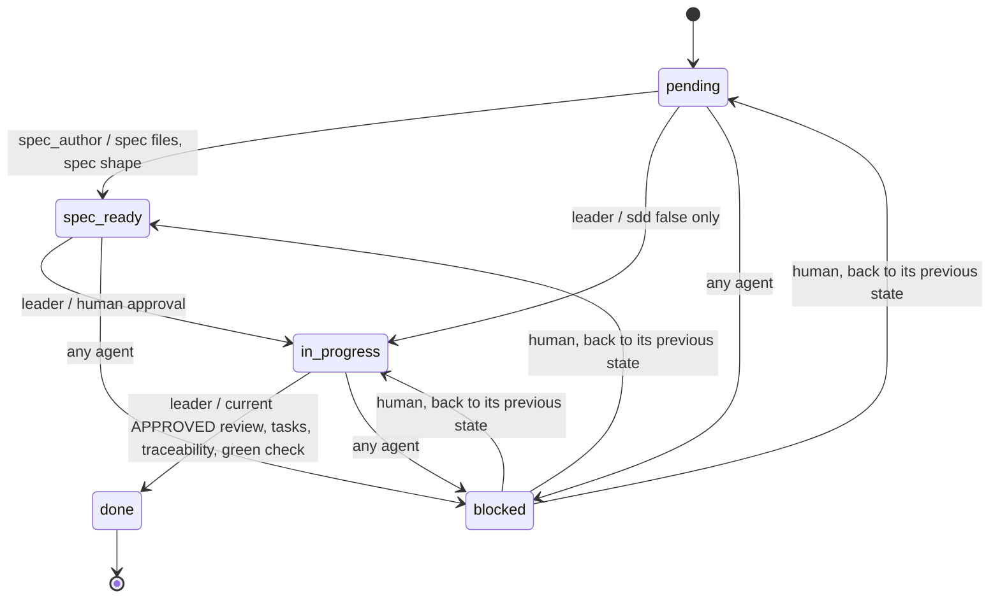

# Rule Layer Overview — Deterministic Decisions in the Harness

> **Status:** implemented. This file explains the design as built. The last section
> is history and describes proposals, not current files.

## 1. The Core Idea

> **An ontology does not give you determinism. A rule layer evaluated OUTSIDE the
> model does.**

Prose is re-interpreted on every turn. That suits ambiguous work, such as designing
a solution or writing a test. It does not suit decisions with one correct answer:
which transition is legal, who may write a path, whether a feature can close.

| Decision | Decided by |
|---|---|
| States, transitions, actors, guards | `.harness/rules.json` |
| Who may write which path | `.harness/rules.json`, enforced by the hook |
| What must hold in any state | `invariants` in `.harness/rules.json`, run by `harness check` |
| The next legal action | `harness next` |
| Requirements, design, code, whether a test is meaningful | Agents and the human |

## 2. How It Fits Together

`.harness/bin/harness` is the only code. `check` validates state and runs tests, `next`
prints one action, `transition` and `debt` change a status under their guards,
`approve` records a human decision, `task start` traces progress, and `resume` prints a
state-only briefing. `hook pre-tool-use` runs before Write, Edit, MultiEdit, NotebookEdit
and Bash, and `hook session-start` injects the briefing, both through
`.claude/settings.json`.

## 3. Lifecycle

An illustration of `.harness/rules.json`, which is the authoritative copy.

`CHANGES_REQUESTED` is not a state. The feature stays `in_progress`, and `harness next`
loops: a rejected review goes to the implementer, and a report newer than the review
goes back to the reviewer.

## 4. Decisions Worth Knowing

- **Evidence freshness.** While a feature is open, file times decide whether a review
  covers the latest report. Closing stores hashes of both reports, because file times
  do not survive a clone; from then on a mismatch always fails.
- **Closing pays debt.** `transition <name> done` writes the feature and its scheduled
  debt of the same `name` as one step, and its guards evaluate that outcome.
- **Approval binds content.** Approval stores spec hashes that ignore checkbox state,
  so ticking a task is progress while any other edit voids the approval.
- **Paying debt in place.** `harness debt` reuses the feature evidence function, so
  rejection loops, staleness and evidence hashes behave the same. An `sdd: false` debt
  counts against the single-active rule, and its `acceptance` is frozen while it is paid.
- **Two next paths.** `next` runs slow guards and tests so it cannot offer a step that
  would be refused. `resume` must stay fast, so it stops at state and says when `next`
  may route elsewhere.
- **Scaffold mode.** With `"stack": null` the hook is passive, so the harness itself
  can be developed. `.harness/config.json` is not writable by agents in a project.

## 5. Enforcement Limits

- File tools are checked exactly. Bash inspection is a **guardrail, not a sandbox**: it
  parses common write patterns, and a determined script can get past it. Build tools
  the role legitimately runs can also write anywhere. Switching branches and
  `git stash` stay allowed although they rewrite files.
- Claude Code treats any hook failure other than exit 2 as non-blocking, so a missing
  `python3` or a removed hook script fails open. `harness check` verifies that the hook
  is wired, not that it ran.
- `harness approve` reads a random code from `/dev/tty`, and the hook denies the
  spellings of it that it can see. A process running as the same user cannot be fully
  stopped: this guards against accidental and routine agent behaviour, not a determined
  adversary. Audit `.harness/approvals/` in code review or CI.
- Script bodies run by an interpreter are not inspected, only the command line.
- `harness check` confirms that each `R<n>` maps to a name that occurs in `src/`, not
  that the test is meaningful. That judgment stays with the reviewer.

## 6. Open Questions

- Should `.harness/CHECKPOINTS.md` be generated from `invariants`, or stay hand-written?

## History: How the Design Was Chosen

This section records the original analysis. File names here were proposals.

The trigger was seeing the same repository state produce different agent conclusions
across runs, with the state machine written three times in three phrasings.

Four options were considered:

- **A. Documentation-only ontology.** Cheap, but still interpretation, so it delivered
  no determinism.
- **B. Declarative data plus a validator.** The chosen core. It was proposed as an
  ontology JSON file and a validation script, and became `rules.json` and the CLI.
- **C. Formal ontology (RDF/OWL, SHACL or Datalog).** Deferred. Inference was not the
  bottleneck; consistency was.
- **D. Executable oracle plus hooks.** The chosen enforcement layer. Without it, B is
  attractive documentation.

The main risk identified then still applies: rules kept in parallel with prose become
two authorities that disagree, so prose must reference the rules, not restate them.
